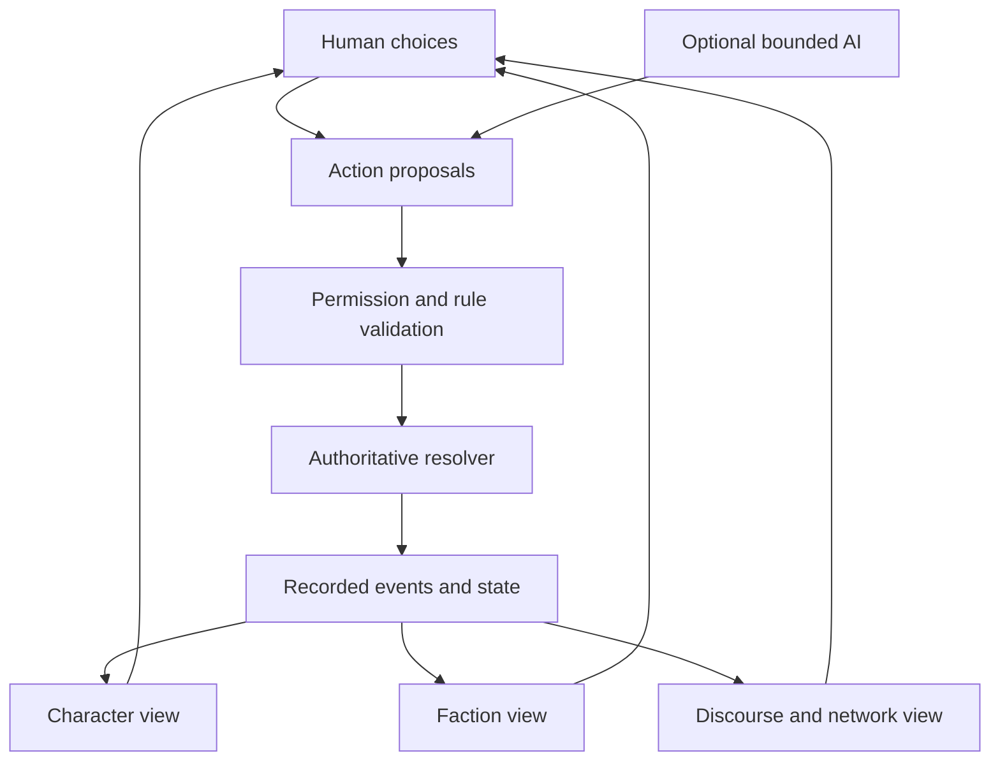

# NoöPunk — long-term vision

**Status: LONG-TERM NORTH STAR. Aspirational.**

This document is a direction, not an instruction. It **authorizes no mechanics, no
canon, no numerical design and no scope**. It does not override
[`AGENTS.md`](../../AGENTS.md), and where the two ever disagree, `AGENTS.md` wins.
Nothing here is a commitment or a date. The plan in §7 ends at a **finished, released,
open-source indie game**; AAA production values and MMO-scale services are **not stages of
it** (§7a).

It exists for one purpose: **to keep the long horizon coherent while every actual
increment stays small.** The releases in §7 are gates, not entitlements. Each one must
deliver a game that stands on its own; the full dream is optional and does not
retroactively justify building it now.

Sources: issue [#309](https://github.com/TomiToivio/NooPunk/issues/309) (this vision),
the crossover directive [#306](https://github.com/TomiToivio/NooPunk/issues/306), the
scaffold [#282](https://github.com/TomiToivio/NooPunk/issues/282) and its layer-design
tracks [#295](https://github.com/TomiToivio/NooPunk/issues/295) ·
[#296](https://github.com/TomiToivio/NooPunk/issues/296) ·
[#297](https://github.com/TomiToivio/NooPunk/issues/297).

**Reading test.** Having read only this file, an agent should be able to answer:
*(a) which game am I working on? (b) what may I build now? (c) what must I not do?
(d) where does the next increment go?* If it cannot, this document has failed and
should be fixed — by hand and by author review, never by a test (§10).

---

## 1. One universe, two games

There is **one fictional universe and two games** in this repository. The distinction is
binding and predates this document ([#306](https://github.com/TomiToivio/NooPunk/issues/306)):

| | Legacy NoöPunk RPG | NoöPunk × LaclauGPT crossover |
|---|---|---|
| Path | `RULEBOOK.md`, `rulebook/`, `src/`, `data/rules/` | `strategy_game/` |
| Rules | its own, unchanged | **NO RULES APPROVED** |
| Status | developed, not to be rewritten | active new game, S0 |
| Timeline | its own default campaign | **acceleration toward** the NHI Crisis |

- **Lore is shared.** Characters, institutions, NHI concepts and prior creative work
  carry over as common setting background, subject to scenario-specific deviations and
  author decisions. **Never delete or casually overwrite old lore.**
- **Rules are not shared.** Legacy attributes, skill procedures, lifepath, character
  sheets and gameplay are **not** canonical for the crossover. Cross-referencing is
  welcome; **importing a mechanic requires an explicit, author-approved conversion.**
- **The legacy RPG is never rewritten to accommodate the crossover.**

See §11 for which existing design documents govern which game — several are legacy-only
and must not be read as crossover doctrine.

## 2. The ultimate game: one Grand Strategy RPG with a God's-eye view

**There is exactly one game.** It is a **Crusader Kings III-style Grand Strategy / Roleplaying
game** in which the player holds a **God's-eye view**: a single overhead strategic map of the
political world, and the ability to zoom from that map all the way down to a named person —
without ever leaving the game, switching modes or starting a different one.

The player is **always a character**: someone with a history, relationships, loyalties,
ambitions and a position inside a faction, institution or state. Power is *held by a person*,
and it can be lost with that person. The strategic map is not a separate wargame layered on
top — it is **the same world seen from further away**, and every event on it resolves down to
people who can be named.

Character RPG, faction strategy, the LaclauGPT-inspired political simulation, geopolitics,
later space strategy and eventually multiplayer are **interacting subsystems of this one
crossover game** — not six games, not six modes, and not six camera perspectives. The
**overhead strategic map plus contextual panels is the enduring interface paradigm**: the map
is the constant, and panels, ledgers and character sheets open over it according to context.

This document uses the word *scale* throughout to mean **a zoom level of the one simulation**.
It never means a separate product.

**Primary genre: New Weird.** The setting is organized around paradigm shift, ontological
mystery and institutions under stress. Social science fiction, science fantasy,
geopolitical satire, investigative mystery, philosophical science fiction, cosmic
strangeness and cyberpunk are **supporting ingredients**. Cyberpunk is *secondary* — a
texture and a politics, not the organizing principle, despite the project's name.

The core period opens with the **acceleration toward the NHI Crisis**, in which three
shifts interact: AGI acceleration and cyborgization; UFO disclosure and NHI awareness;
and psychic awakening, psionics and psychotronics. Political disruption begins **before**
full crisis. Ideologies that emerge around these shocks — including AI doomerism, NHI
infiltration paranoia and novel single-issue populisms across the spectrum — are
simulated as **contestable perspectives, never as inevitable truths**.

Tone shifts contextually: comic, bureaucratically absurd, tragic, cerebral, genuinely
alien. New Weird is the umbrella; social science fiction and dark science-fiction comedy
are deliberate modes.

## 3. One game, many zoom levels

The God's-eye map is always present. Zooming in does not change the game — it reveals more
detail of the **same** simulation, and the same clock keeps running at every zoom level.
Nothing here is a mode the player enters or leaves.

The **Crusader Kings III structural model** is the benchmark: a named character with traits,
relationships, secrets and ambitions; an overhead map of realms, factions and networks; a
single turn structure advancing both together; and succession, rivalry and consequence
linking them, so that losing the person loses the power. NoöPunk's version keeps that spine
and replaces the feudal map with institutions, discourse networks and a state under
ontological stress.

| Domain (zoom level of the one game) | What the God's-eye map shows | What zooming in reveals |
|---|---|---|
| **Person** | a named figure, their affiliations, and the missions they are on | lifepath, relationships, dilemmas, meaningful choices and consequences — as an UNSA field agent, scientist, journalist, activist, diplomat, hacker, psychic, posthuman or faction leader |
| **Organization / faction** | blocs, cells, corporations, institutes and their rivalries across the map | leaders, assets, recruitment, operations, covert and overt power, delegation |
| **Society / discourse** | contested narratives flowing through communication networks | signifiers, frontiers, legitimacy and coalitions. **Abstract and gameable**, never the research stack |
| **Nation / planet** | states, institutions and the shape of global governance | diplomacy, UNSA, crisis response, science, conflict, surveillance, trust |
| **Solar system / beyond** | settlement and polities beyond Earth, once reachable | posthuman polities, asymmetric civilizations, unknown realities |
| **Persistent world** | other players' and LLM factions acting in the same history | delegated agents, asynchronous play, moderation and governance |

**Zoom-level continuity.** Consequence travels in both directions through one model: a
discovery can change a faction's strategy; its public reading can move discourse; alignment
can shift state policy; strategy can create personal missions. The player may **work at any
zoom level and delegate, abstract or ignore the others** — delegating is a decision inside the
game, not a switch to a different one.

*Illustrative causal chain — fiction, not a chosen mechanic:* an investigator finds
ambiguous evidence of possible NHI involvement → a faction leaks it → rival populists
frame it as liberation versus infiltration → communication networks amplify both frames →
legitimacy and coalitions shift → governments revise cooperation → new investigation and
diplomacy missions become playable. **Genuine ambiguity is preserved; nothing "must"
happen.**

## 4. Design pillars

These are written as **tests**, so a proposed feature can be rejected against them.

1. **New Weird first.** Paradigm shift and ontological mystery outrank hardware. NHI,
   PSI, AGI and psychotronics are game-world elements, **not claims about real science**.
2. **Social science as design, not as proof.** Laclau's content of struggle, Castells's
   network structure and power, and agent-based institutions give *interpretable*
   inspiration. The simulation is a **simplified game model**; no claim that theory
   mathematically determines an outcome is permitted.
3. **Character agency *and* structural forces.** Motivations and relationships coexist
   with faction strategy, ideology, networks and institutions. Neither spreadsheet
   geopolitics nor empty exploration.
4. **Something interesting at every scale, and little dead air.** Terra Invicta's breadth,
   far smaller and faster — dense decision loops, unexpected crises, real tradeoffs.
5. **Architect / Agent delegation.** Hands-on missions versus strategic orders;
   subordinates have interests and can surprise the player, while play stays legible.
6. **Human/LLM parity of *roles*, not of implementation.** A human or an AI may inhabit an
   NPC, leader, faction or diplomat — within explicit permissions, compute budgets and
   anti-abuse boundaries. LLM play is a bounded participant, never an unbounded optimizer.
7. **Simulation first, presentation later, inside indie reach.** Headless world model and
   playable text/2D interfaces first; a modest, presentable 2D strategy map and its panels
   next. Nothing beyond that is planned, and no release may wait on cinematic production.
8. **Persistent causality and legibility.** The game must be able to explain *why* society,
   loyalties and power changed. Deterministic rules, randomness, LLM-generated content,
   authored canon and in-world claims are **distinguishable**, always.
9. **Player and creator agency.** Scenario editing, faction and leader creation, modding
   interfaces, user campaigns, community storytelling — and, at the far horizon, shared
   world-building with moderation.
10. **Shippable scope.** The goal is a **finished open-source indie game**, not an ambition to
    grow into something larger. Solo play must always be viable, with or without multiplayer
    or optional model support. This pillar outranks the rest when they conflict.

## 5. Technical architecture (candidates, not commitments)

- **Engine-neutral, versioned** simulation and world-state API. Initial implementation
  lightweight **Python**, with explicit person / faction / discourse / world data
  contracts. Candidate libraries: dataclasses or Pydantic, NetworkX, optionally Mesa.
  **The core simulation must run with no LLM, no database service, no 3D engine and no
  network server.**
- **Independent layers:** RPG decision and resolution; character relationships and the
  organizational/agent layer; the simplified Laclau–Castells political simulation; global
  strategy; optional off-world simulation.
- **Model-assisted behaviour is a proposal layer.** Plug-in Ollama or cloud providers may
  generate dialogue, interpretation, deliberation and procedural scenarios. **LLM output
  never mutates authoritative state**; it is checked against authorized actions, canonical
  facts, rules and budgets.
- **Determinism and inspection:** recorded action/event log, seedable resolution,
  snapshots, replay tools, versioned schemas, explicit provenance. **Stochasticity lives
  in the proposal layer, not in the authoritative result.**
- **Interfaces:** CLI/text and a minimal 2D map first; a polished strategy map, character
  scenes and mission UI later; engine clients are extensible and **Godot is one candidate,
  not a locked choice**.
- **Multiplayer, far later:** authoritative server, permissions, access-controlled state,
  rate limits, persistence, rollback and conflict resolution; human/human, human/LLM and
  LLM/LLM interaction **without unlimited autonomous operation**.
- **Modding and UGC:** data-driven events and entities, a documented scenario format,
  stable extension contracts, content provenance and licensing, moderation, optional
  publishing. **Never copy proprietary code, assets or rules text** from any referenced
  commercial game.

## 6. Reference studies

Inspiration for study, never a source to port. **No proprietary rules text, assets or code
is copied or depended upon.**

- **Terra Invicta** — multi-faction geopolitical and space strategy, councilors, crisis.
  Proprietary but moddable; a *prototype mod* path may be studied, but a total conversion
  must never be presumed releasable as a standalone product.
- **Democracy 4** — policy choices, voter blocs, feedback loops.
- **Crusader Kings III** — character-focused long-horizon strategy and emergent narrative.
- **Dune: Adventures in the Imperium** — Architect/Agent framing and strategic delegation.
- **Eclipse Phase** — deep transhuman and existential science fiction for the RPG layer.
  **Licensing boundary:** EP-derived material is CC BY-NC-SA, so it is **non-commercial** and
  cannot enter a released, distributable build. Keep it isolated, marked and attributed
  (§7a).
- **Cyberpunk 2077** — a benchmark for AAA production values at AAA budget, studied so that
  this project knows what it is **not** attempting. Not a scope target, not a camera to copy.
- **Stellaris** — expandable civilization-scale strategy and emergent history.
- **EVE Online** — persistent player-led geopolitics, organizations, living economy.
- **Citizen Sleeper** and **Disco Elysium** — dense decisions, character voice, unusual
  institutions, minimal wasted movement.
- **NoöPunk tabletop rulebook and lore** — shared universe where relevant, but **the
  crossover is a separate scenario, game and rules implementation**, not a forced merger
  of rulebooks.

## 7. The plan: an open-source indie game, shipped in stages

**Product target.** The destination is a **finished, released, open-source indie game** — small
enough for one developer plus contributors, complete enough to be worth playing on its own, and
free to study, modify and redistribute. That is what the plan builds. Anything beyond it is a
*possibility that would need its own author-approved issue*, **not a horizon this plan climbs
toward.**

**Release-shaped, not horizon-shaped.** This plan is a sequence of **releases that each ship**,
not a ladder of growing ambition. Every release must be independently playable, and a release
that is not fun is not rescued by the next one's systems. No dates; no commitments.

**S0 — Paper, then a prototype. Approval before runtime.**
The design gates come **before** any playable mechanics. This is the content of the former H0
stages, kept because the sequence is the point: editorial judgement gates the code, not the
reverse.

- **S0-A — design gates.** *Before any playable mechanics:* review the layer proposals
  **separately** with the author and other agents, selecting only the necessary leader attributes
  and tags, faction decisions, political representations and interactions. No new numerical
  ranges, costs, randomness or canonical actors are assumed. Write a **one-page vertical-slice
  proposal** naming the player, the initial tension, the integrated map and its contextual panels,
  one illustrative consequential decision, the ending and the estimated cognitive burden — author
  approval required before mechanics. Specify a **paper-playable version** of the proposed leader,
  faction and discourse rules, reviewed separately, with cross-layer event propagation as its own
  fourth gate. Identify which facts are historical, invented, factional, simulated or uncertain;
  **never conflate media reach with persuasion, or a game score with measured hegemony.**
- **S0-B — minimal runtime, after those approvals.** Python standard library as baseline, all
  adapters optional; the existing empty scaffold and view model are a starting point, not a request
  to restructure. Interfaces rather than a committed file layout: validated command intent,
  authorized rules resolver, versioned world snapshot, append-only event and provenance record,
  projections for character card, faction board and discourse graph **on one overhead strategy
  screen**, save/load/replay, and a minimal text or 2D strategy UI. One explicit player decision
  should yield a clearly explained event and changes visible in the linked panels **without
  leaving the map**. Seed randomness and record inputs so resolution can be replayed. Verified with
  **behavioural tests for executable code only** — command validity, save/load, deterministic
  replay, no unauthorized state mutation, consistent event-to-view projections — and never with
  tests over design prose, lore or canon.
- **S0-C — graduation to S1.** The author has explicitly approved every mechanic and scenario
  element used; a fresh player can finish a complete session without reading the research
  framework; every meaningful change has an inspectable in-game explanation; the game runs, saves
  and loads **offline with no LLM, database, Mesa, Godot or server**; and scope stays small, with no
  empty-turn slog.

*Gate:* a complete, fun, explainable mini-scenario one person can finish.
*Kill switch:* any system that cannot be explained on a table.

**S1 — The indie release. This is the actual goal.**
A complete, finishable, presentable open-source indie game: one campaign covering the acceleration
toward the NHI Crisis, one playable faction leader with a small cast, rival factions, decisions and
events, a legible 2D overhead map with contextual panels, saves and loads, and a closing summary
that explains what changed and why — with **no required LLM, database or network service**. Shipped
under an **open-source software licence** for the code and an **open content licence** for
NoöPunk-original material, with a published attribution and provenance policy (§7a, and the licence
documents referenced there). Reached in three milestones, **each of which must be playable**:

- **S1-a — first public playable: the MVP.** The first thing a stranger can download and enjoy —
  **the MVP defined in §7b**: one small scenario containing the Strategy, Simulation and RPG
  pillars at reduced scale in a single loop, published open source with a licence, a README and a
  documented save format.
  *Gate:* a stranger on the internet plays a full session to the end without help.
  *Kill switch:* anything that requires an account, a server or a paid dependency.
- **S1-b — content-complete.** The vertical slice becomes a full, coherent small campaign: character
  creation and lifepath, leaders and agents, discourse and network play, geopolitics, scenario
  authoring, an appealing 2D interface, saves and replay, and a complete NHI-acceleration campaign,
  with modding and scenario data formats documented.
  *Gate:* repeatably enjoyable, and other people can author scenarios without reading the source.
  *Kill switch:* interface polish displacing rule coherence.
- **S1-c — 1.0.** A released game: balanced, documented, moddable, accessible, with contributor
  documentation, a contribution and provenance process, a content-licence statement, and a
  UGC/moderation policy before any community content pipeline opens. Optional bounded LLM character
  play, if it can be **switched off** without losing the game.
  *Gate:* a finished game we would honestly put our names on, playable offline forever.
  *Kill switch:* any feature that makes the game unusable without a live service.

**S2 — Post-release depth, driven by real players.** *(Unscheduled.)*
Fixes and balancing from actual play, deeper political and institutional simulation, richer
character relationships, a scenario editor and a documented mod format, community scenarios, and
*optional* bounded LLM-driven characters behind a clearly marked setting.
*Gate:* players keep playing and modding it, and the added depth is legible rather than opaque.
*Kill switch:* LLM cost or latency, or content sprawl, becoming load-bearing.

**S3 — Optional, community-scaled expansion.** *(Unscheduled.)*
Broader Earth strategy and, only if the released game has proven itself and contributors have
arrived, a selective off-world layer. Abstract distant regions aggressively; **do not simulate what
a small team cannot maintain.**
*Gate:* evidence of demand plus maintainers, not ambition.
*Kill switch:* any system that only produces waiting or maintenance burden.

**S4 — Optional persistent multiplayer.** *(Unscheduled, not planned.)*
Private and small co-operative play first; shared persistent worlds only if someone can genuinely
operate, moderate and fund them, with explicit permissions, rollback and conflict handling. The
project **does not plan, promise or architect for a public MMO-scale service.** If it never happens,
the game is unaffected.
*Gate:* a real operator, a real governance model and real economics — otherwise it does not start.

**Explicitly not planned.** AAA production values and MMO-scale operations are **out of scope as
planning targets**. They may be discussed as distant fan-scale possibilities, but no stage, no
architecture decision and no roadmap commitment may depend on them, and **no agent may use them to
justify added scope, staffing or infrastructure.** This is what keeps the indie target honest.

### Release ledger

| Stage | Ships | Gate | Kill switch | Owning issue |
|---|---|---|---|---|
| S0 | paper rules + minimal prototype | author-approved design gates precede code | a system that cannot be explained on a table | #282, #295, #296, #297 |
| S1-a | first public open-source playable | a stranger finishes a session unaided | needs an account, server or paid dependency | *unassigned* |
| S1-b | content-complete small game | repeatable, third-party authoring works | polish over coherence | *unassigned* |
| S1-c | 1.0 release | a finished game, offline forever | unusable without a live service | *unassigned* |
| S2 | post-release depth from real players | players keep playing and modding | LLM cost or content sprawl | *unassigned* |
| S3 | optional community-scaled expansion | demand plus maintainers | systems that only add burden | *unassigned* |
| S4 | optional persistent multiplayer | a real operator and governance model | — | *not planned* |

**Only S0 has an owning issue, and that is deliberate.** Assigning owners to S1–S4 before S0
graduates would be the scope creep this document exists to prevent.

## 7a. Open-source indie requirements

These are **requirements of the project**, not aspirations. Any proposal that breaks one of them
is out of scope until the author changes this section.

- **The game is open source.** Source is released under an OSI-approved licence chosen by the
  author, and it must be **possible to build and run the game from source** with ordinary
  dependencies, **offline**, without an account and without a service. The repository already
  treats **code and content as separate licensing questions** — the licence ledger work in
  [#200](https://github.com/TomiToivio/NooPunk/issues/200) covers rules prose, data and lore;
  **source code needs its own software licence**, and that choice is the author's.
- **Non-commercial sources must stay out of the release.** Eclipse Phase-derived material is
  CC BY-NC-SA, and the existing EP2 homebrew prototype with it. A released game cannot absorb
  NC-licensed content, so that material stays **isolated, marked and attributed**, and never enters
  a distributable build. This is the largest clean-up obligation before S1, and the licence
  documents in the repository — the
  [#200](https://github.com/TomiToivio/NooPunk/issues/200) release gate, notice plan and packaging
  guard — hold the binding detail rather than this document.
- **Nothing proprietary is depended on.** No Terra Invicta, Crusader Kings III, EVE, Stellaris or
  other commercial game's code, assets or rules text is copied, linked or required. They are
  **studied**, never ported. A total conversion of anyone else's game can never be presumed
  releasable.
- **Every third-party asset carries provenance.** Original, or compatibly licensed with
  attribution recorded. No "found it on the internet" art, music, fonts or text.
- **Contributions are traceable.** Contributor documentation, a provenance or sign-off convention,
  and a clear boundary between *code* (tested, reviewable) and *canon, lore and rules prose* (which
  the author owns and reviews editorially).
- **It must be moddable, and the data formats documented**, because an open-source indie game
  grows through its community, not through its budget.
- **Sustainability is an author decision, not an agent's.** The core game is not paywalled. Whether
  there is any commercial model at all — donations, a paid expansion, nothing — is **recorded here
  once the author decides it**, and is not invented by a contributor.
- **No feature may require a live service, a proprietary engine or a paid model provider to be
  playable.** Optional LLM support stays optional, and switching it off must leave a complete game.

## 7b. The MVP: the smallest game that still has all three pillars

**Definition.** The MVP is **one small, complete, playable scenario that genuinely contains a
Strategy layer, a Simulation layer and an RPG layer at reduced scale** — playable in a single
sitting, offline, with no LLM, database or server, released open source. It is a *small game*, not
a demo of an architecture and not a slice of one pillar. If any of the three is missing, it is not
the MVP; it is a prototype (S0).

**This section fixes *scope*, not rules.** Every count below is a **provisional envelope to be
approved at S0-A**, not a mechanic, a number or canonical content. Nothing here selects a
mechanic, and nothing here may be treated as approved design.

### The three pillars, scaled down but present

| Pillar | The MVP must have | It need **not** have yet |
|---|---|---|
| **Strategy** (God's-eye) | one overhead map of a few abstract regions; a handful of competing factions that also act; turn-based decisions with **visible power shifts the player can read** | deep economy, military stacks, tech trees, space, procedural maps |
| **Simulation** (political / discourse) | opinion and legitimacy that move **for reasons the player can inspect**; at least two competing public narratives; a small communication network whose *shape* matters; events driven by the state | full Laclau–Castells depth, dozens of signifiers, measured-hegemony claims |
| **RPG** (character) | one playable leader with traits, a few named relationships, choices with real consequences, and a **personal position that affects the strategic layer** | lifepath depth, large cast, portraits, dialogue trees, succession dynasties |

**The single most important design property:** the three pillars must **feed each other in one
loop**. A leader's decision changes faction standing; that changes discourse; that changes who
cooperates; that creates the next personal decision. If the pillars are three disconnected
mini-games sharing a menu, the MVP has failed even if all three exist.

### Hard caps — what "scaled down" means concretely

*Provisional envelopes, for approval at S0-A:*

- **One** map, **one** scenario, **one** finite campaign. No second map, no campaign selector.
- **A single sitting**: one session, minutes not hours, with a real ending.
- **Content budget in the handfuls, not dozens**: a few regions, a few factions, a few named
  characters, a few events. If a content list is longer than a page, it is out of MVP scope.
- **One resolution mechanism, reused everywhere** — not one per pillar.
- **No engine work**: 2D or text-readable overhead map only. No 3D, no art production, no engine
  migration.
- **No required model, service or account.** Optional LLM support, if any, is off by default and
  its absence must leave a complete game.
- **No multiplayer, no space, no economy simulation, no mod UI** — documented data files only.

### Explicitly out of the MVP

Procedural generation; deep economy or logistics; dynastic succession; off-world content;
multiplayer or persistence; LLM-driven NPCs as a dependency; art, portraits or audio production;
a polished UI framework; a scenario editor; an MMO-anything. Each of these is legitimate later and
**none of them justifies delaying the MVP.**

### Definition of done

The MVP ships when:

1. a stranger can run it from source, offline, and **finish a full scenario in one sitting**;
2. they can **explain why power shifted** — every meaningful change has an inspectable in-game
   reason;
3. all three pillars are present, and **removing any one of them would obviously break the game**;
4. the source is public under the licences in §7a; and
5. it is **enjoyable enough that we want to keep building on it.** If it is not, the correct next
   step is to fix or cut, not to add scope.

**The MVP is the target of S1-a.** Everything in S1-b, S1-c and S2–S4 is what happens *after* an
MVP exists and has been played.

## 8. Non-goals for current agents

- Do **not** attempt to build an AAA RPG, a grand strategy game and an MMO simultaneously. The
  plan in §7 ends at a **finished open-source indie game**; anything past that is not a stage of it.
- Do **not** scale the MVP up toward the vision. Scale the vision down to the MVP (§7b): cut
  regions, factions, characters and events before adding a system, and never add a fourth layer
  to the three-pillar MVP. The vision is the direction the MVP must not contradict — it is not
  the build target.
- Do **not** add a dependency that stops the game being built and run **from source, offline,
  without an account and without a paid service**.
- Do **not** copy, link or require any commercial game's code, assets or rules text, and never
  presume that a total conversion of someone else's game could be released.
- Do **not** choose the licence or invent a commercial model — those are author decisions, recorded
  in §7a once made.
- Do **not** import the LaclauGPT research pipeline, claims of scientific causal certainty,
  or proprietary game content.
- Do **not** rewrite existing NoöPunk RPG rules, invent canon, select or implement new
  mechanics, or expand the scope of #282 / #295 / #296 / #297 without author approval.
- Do **not** replace local, testable rules with non-deterministic LLM-only gameplay.
- Do **not** require high-fidelity art, online infrastructure, enormous space maps or
  continuous simulation for the first playable prototype.
- Do **not** treat this document as approval for anything. It has none to give.

## 9. Open design artifacts

Each is a future piece of work, carried by a scoped issue rather than built from here.

- [ ] A **one-page playable vertical-slice pitch** — actions at person, faction and discourse scales.
- [ ] A **cross-scale world-state and event-flow architecture** — where consequence travels, and where simulation is abstracted.
- [ ] **Candidate engines, Python-to-engine bridges and licensed/modding prototypes**, findings kept non-binding.
- [ ] **Separation of human-played, LLM-played and rules-driven roles**, with the limits of delegation.
- [ ] The **MVP size envelope** — the concrete region, faction, character, event, turn and save
  counts, author-confirmed at S0-A, replacing the provisional "handfuls" in §7b.
- [ ] The **release matrix** with dependencies and kill switches — extended from §7's ledger.
- [ ] **UGC governance** — moderation, canon conflicts, multiplayer trust, attribution.
- [ ] **Playtesting criteria** — engagement per minute, meaningful consequences per turn, clarity of power shifts, replayability, operational cost.
- [ ] A **discipline check**: the vision re-read against the three-layer prototype, so immediate development stays small.

**Delivered as separate records, and kept non-binding.** These items are research, so they land in
their own files rather than in this vision, and they decide nothing here:

- [`ISSUE_309_ENGINE_AND_RELEASE_SCOPE.md`](ISSUE_309_ENGINE_AND_RELEASE_SCOPE.md) — the
  **candidate engines** survey against §7a's hard constraints, and the **release-scope statement**
  (what S1-a must contain to be shippable, and what is explicitly deferred to S1-b/S1-c/S2/S3). Its
  engine recommendation is a proposal for the author.
- [`ISSUE_309_DISTRIBUTION_AND_UGC_GOVERNANCE.md`](ISSUE_309_DISTRIBUTION_AND_UGC_GOVERNANCE.md) —
  **distribution channels, price, storefront requirements, packaging and platform support**, and the
  **UGC governance research** (modding, community content licensing, attribution, and how a
  community contribution meets the NC-SA clean-up obligation).

Neither record selects a licence, a commercial model or a mechanic, and **the MVP size envelope and
the licence pair therefore stay open** here — the first at S0-A, the second in
[#421](https://github.com/TomiToivio/NooPunk/issues/421).

## 10. How this document changes

- **Vision is not commitment.** Nothing here may be cited as approval, as a requirement, or
  as a reason to skip a gate.
- **Revisions go through an issue**, and land as a small reviewable change. An agent must
  not opportunistically extend this document while doing unrelated work.
- **Mechanics never live here.** If a proposal needs rules, statistics or numbers, it belongs
  in a scoped design issue, not in the vision.
- **This file is never guarded by tests.** Per `AGENTS.md` and
  [#271](https://github.com/TomiToivio/NooPunk/issues/271), the automated-test policy covers
  executable code only. No CI assertion, snapshot, schema lock or smoke step may check this
  document's prose, structure or wording. It is reviewed editorially and by playtesting.

## 11. Which documents govern which game

Several existing design documents belong to the **legacy RPG** and are not crossover
doctrine. Read them with the table in §1 in hand:

| Document | Governs |
|---|---|
| [`docs/design/GAMEPLAY_LOOP.md`](GAMEPLAY_LOOP.md) | legacy RPG |
| [`docs/design/DEFAULT_INVESTIGATION_FANTASY.md`](DEFAULT_INVESTIGATION_FANTASY.md) | legacy RPG — **post-Singularity** default campaign |
| [`docs/design/RULEBOOK_STRUCTURE.md`](RULEBOOK_STRUCTURE.md) | legacy RPG |
| [`docs/design/LORE_CHAPTERS_SCOPE_2026-10-07.md`](LORE_CHAPTERS_SCOPE_2026-10-07.md) | legacy RPG lore |
| [`strategy_game/docs/POLITICAL_SIMULATOR_SCOPE.md`](../../strategy_game/docs/POLITICAL_SIMULATOR_SCOPE.md) | crossover |
| [`strategy_game/docs/POLITICAL_SIMULATION_DESIGN.md`](../../strategy_game/docs/POLITICAL_SIMULATION_DESIGN.md) | crossover |
| [`strategy_game/docs/POLITICAL_SIMULATOR_MODEL.md`](../../strategy_game/docs/POLITICAL_SIMULATOR_MODEL.md) | crossover |
| [`strategy_game/docs/RULE_SYSTEM_RESEARCH.md`](../../strategy_game/docs/RULE_SYSTEM_RESEARCH.md) | crossover |
| [`strategy_game/docs/INTEGRATION_BOUNDARIES.md`](../../strategy_game/docs/INTEGRATION_BOUNDARIES.md) | crossover |
| [`strategy_game/RULEBOOK.md`](../../strategy_game/RULEBOOK.md) | crossover — **placeholder, NO RULES APPROVED** |

**The timeline warning is the one to internalize.** The legacy default campaign is set
*after* the Singularity. The crossover begins in the **acceleration toward** the NHI
Crisis, with everyday institutions and ordinary electoral politics still recognizable.
The two are not interchangeable, and this vision does not move either one.

---

*This document implements [#309](https://github.com/TomiToivio/NooPunk/issues/309). It grants
no permissions, changes no rules, and invents no canon.*

## 12. Proposed first playable slice

Implementation-plan baseline, inspected on 2026-10-11: `core.py` provides serializable `WorldState`, a schema-version field and provenance; `ports.py` contains reserved protocols. There is no playable turn engine. `politics.py` is integrated with `WorldState`, while `political.py` remains a separate vocabulary proposal. The plan below builds on that distinction.

**Proposal for discussion in #282 and #295–#297, not an approved scenario or mechanic.**

Player promise: lead a faction through a short, consequential episode of the acceleration toward the NHI Crisis, moving between a personal dilemma, an organizational decision and a visible public interpretation. Use an author-selected small cast and abstract board. Present choices as text and cards before investing in exploration or cinematic environments.

Adapt the illustrative chain in §3: ambiguous evidence reaches the player; the leader chooses a response; the faction acts or delegates; competing interpretations travel through the declared network; the approved resolver produces consequences; those consequences create the next personal decision. The ending should show what changed and why, including unresolved interpretations. Evidence, a faction's claim and an established fictional fact must remain distinguishable.

The first slice needs only the actions, resolution procedure and ending conditions selected in the three layer discussions. It must be playable by a human without an LLM and expressible with a physical board/cards/dice if the approved rules require them. No numbers, action economy, dice model, faction taxonomy or canonical incident are selected here.

## 13. Cross-scale authority and event flow

**Proposed future architecture.** The current scaffold stores declared data; the command validator, resolver and replay machinery below do not exist yet. Implement only the portion required by an approved slice.

One accepted action is resolved once. Views show its consequences; they do not independently recalculate or award them. Approved cross-scale consequences become explicit events, with causal references, rather than hidden mutations inside UI or dialogue. Later scales can use coarser updates; identical tick rates and continuous global simulation are unnecessary.

Start from `core.py`, `ports.py`, `provenance.py` and `view.py`, preserving the boundaries in [INTEGRATION_BOUNDARIES.md](../../strategy_game/docs/INTEGRATION_BOUNDARIES.md). Extend serialization only as needed. A future replay record should identify the initial snapshot, rules/schema versions, accepted inputs, recorded random outcomes and resulting events. A seed alone cannot reproduce changing model responses or changed code. Record accepted LLM proposals; replay must not call the model again.

| Controller | May do after relevant rule approval | Authority boundary |
| --- | --- | --- |
| Human | Choose a permitted action, inspect available information, delegate | Same action validation as other controllers |
| Rules-driven actor | Select among approved actions using an explicit policy | No privileged state mutation |
| Optional LLM actor | Propose structured actions and dialogue from permitted context | Validate actor identity, knowledge, action permissions and budget; reject invalid proposals |
| Resolver | Apply approved rules and recorded randomness | Sole writer of resolved gameplay state |
| Scenario author / GM | Supply approved content and use explicitly defined GM capabilities | Authored content and interventions retain provenance; no silent canon promotion |

Delegation needs an explicit mandate, stopping conditions and an inspectable result. Permissions concern both what an agent can do and what it can know. Timeouts and invalid model output must have an approved fallback, such as returning control to the human; they must not invent an action or outcome.

## 14. Implementation sequence grounded in the repository

These are proposed work packages, not additional authorization. Continue the existing issues rather than opening duplicate implementation tracks.

| Step | Existing home | Concrete deliverable | Exit condition |
| --- | --- | --- | --- |
| A. Select the minimum rules | #295 leader; #296 faction; #297 discourse/network | Author-selected procedures recorded in `strategy_game/RULEBOOK.md`, including unresolved questions | Each selected procedure can be exercised without software |
| B. Reconcile the data model | #282 integration and #297 vocabulary | Explicit mapping or consolidation decision for `politics.py` and `political.py`; stable identifiers and provenance semantics | One agreed representation for slice transitions; no silent loss of existing records |
| C. Specify the shared turn | #282, after A and B | Inputs, action ownership, ordering, randomness, rejection behavior and cross-layer consequences | An author-reviewed worked turn explains every state change |
| D. Implement the small resolver | Scoped follow-up to #282 | Headless Python implementation of the approved procedures and executable behavior tests | Human-controlled slice runs offline; views cannot alter state |
| E. Make the slice finishable | #282 integration, after C and D | Approved scenario, text interface, end summary, save/load and inspectable event history | One person can finish and explain the consequences |
| F. Playtest before expansion | #282; later S1 decision | Playtest notes and a small prioritized revision list | Author accepts pacing, clarity and replay value before adding scope |

Rule selection, not engine selection, is the immediate dependency. NetworkX, Mesa, a database, Godot, Concordia and model providers remain optional candidates. Select libraries only when an approved requirement makes the standard-library approach inadequate. Do not build a distributed platform to serve an empty turn loop.

### Horizon feature/dependency ledger and scope kill switches

| Horizon | Deliverable focus | Dependency and evidence for proceeding | Scope kill switch | Status / work home |
| --- | --- | --- | --- | --- |
| S0 | Tiny leader–faction–discourse slice | Steps A–F; a complete explainable episode | Reduce scenario breadth and presentation; retain consequential choices | Scaffold exists; rules pending in #282/#295–#297 |
| S1-a | First public open-source playable | S0 graduation; a stranger finishes a session unaided | Cut anything needing an account, a server or a paid dependency | Unscheduled proposal |
| S1-b | Content-complete small game with authoring tools | S1-a enjoyment established; usable saves and a coherent content pipeline | Keep text/cards; postpone engine migration and cinematic scenes | Unscheduled proposal |
| S1-c | Balanced, documented, moddable 1.0 | Legible causes, affordable cost, working modding and contributor process | Disable optional model agents; retain authored content and rules-driven play | Unscheduled proposal; #304 is related agent design, not multiplayer approval |
| S2–S4 | Post-release depth, optional expansion, optional multiplayer | Evidence of demand and maintainers; a real operator for any server | Ship the smaller game; no AAA/MMO dependency imposed on earlier releases | Aspirational only |

## 15. Playtest and research plan

Collect evidence for gates instead of setting arbitrary numerical targets now. Establish a baseline with the first playable slice, then agree targets with the author.

| Question | Evidence to collect | Design response if it fails |
| --- | --- | --- |
| Is time spent deciding? | Session duration, decision points and idle/repetitive intervals | Cut upkeep and empty turns |
| Do choices matter? | Consequences traceable to chosen actions; comparison of alternative playthroughs | Revise approved options and feedback before adding content |
| Can players explain political change? | Player account of changes compared with the event history | Improve explanations and simplify hidden interactions |
| Is the story worth replaying? | Different strategies and endings within approved scenario content | Improve consequential variation, not map size |
| Can it run economically? | Turn latency; optional model calls, tokens and cost per session | Reduce model frequency or use rules-driven actors |

Tests cover executable behavior once implemented: rejected actions leave state unchanged, accepted consequences apply once, save/load preserves state, and replay reproduces recorded resolutions under the same versions. Review this vision and all creative content editorially and through playtesting. Add no prose, canon or rulebook CI gates.

### Research still required

The references in §6 are study prompts, not completed comparative research. The existing issue discussion additionally suggests **Suzerain**, **Dwarf Fortress** and **Mount & Blade** for studying political narrative and cross-scale continuity. Assess those references before selecting adaptations.

Before choosing a frontend, compare a minimal text/card client with candidate Python and engine clients against the same approved slice: input, accessibility, packaging, save compatibility and deployment effort. Before proposing a proprietary-game mod, verify the current official modding documentation and redistribution permissions. A mod experiment must not become a dependency of the standalone game.

Before any multiplayer release, separately decide scenario-versus-world canon, creator attribution and licenses, content validation, moderation and appeals, hidden-information access, griefing controls, server recovery and incompatible mod handling. These need explicit design and operational decisions; a provenance field alone does not solve them.

## 16. Document acceptance and maintenance

This file supplies a first slice pitch, proposed event-flow diagram, controller boundaries, implementation sequence, release ledger and playtest plan. Engine research, detailed UGC governance and the actual mechanics remain open. These proposals do not mark the issue's entire research checklist complete.

A reader should be able to identify the game they are working on, the existing rule-authoring issues, the next scoped deliverable and the conditions for stopping expansion. Review that manually. Direct author instructions and approved scoped decisions govern implementation; a vision edit alone does not approve mechanics or expand a milestone.

Reconcile this document when #309 or the relevant author decisions change, updating the reconciliation date and preserving the distinction between implemented capability and aspiration. Keep #309 available as the north-star discussion; completion of this document does not mean the ultimate game has been implemented.

## 17. Development roadmap: RPG first, then organizational strategy, then grand strategy (#502)

**Where this section comes from.** Issue [#502](https://github.com/TomiToivio/NooPunk/issues/502)
specifies the **build order** for the crossover game: one NoöPunk game is built incrementally,
beginning with a playable investigative RPG and layering strategy mechanics on top of the **same
shared world state**, instead of implementing the entire grand-strategy simulation up front. This
section records that sequence, its premise and its cross-phase rules in the canon design file, so
that the build order is not parked in an issue body.

**What this section does, and does not do.** It **adds** a scope axis and a build order. It does
**not** rename, renumber or reinterpret §7's release stages, does not select a mechanic, number,
cost, probability, cadence, faction taxonomy or scenario content, does not date anything, and does
not replace §7b's MVP or §12's first playable slice.

**Guiding progression:** *X-Files-scale investigative RPG → X-COM-scale organizational strategy →
Terra Invicta-scale faction grand strategy.*

### 17.1 Two axes: release stages and scope phases

This document now carries **two independent development axes**. Neither renames the other, and
neither may be read as the other.

| Axis | The question it answers | Values | Where it is defined |
|---|---|---|---|
| **Release stages** | *How finished, and how public, is the shipped game?* | **S0** paper and prototype design gates → **S1-a / S1-b / S1-c** the indie release, in three playable milestones → **S2** post-release depth → **S3** optional community-scaled expansion → **S4** optional persistent multiplayer | §7, its release ledger, and §14's horizon ledger |
| **Scope phases** | *How much game exists in the build, and in what order is it added?* | **Phase 1** X-Files-scale investigative RPG → **Phase 2** X-COM-scale organizational strategy → **Phase 3** Terra Invicta-scale faction grand strategy | this section (§17.3–§17.5) |

**Shorthand, fixed here so the rest of the repository can use it unambiguously.** In this repository
**S0–S4** always means the **release stages** (§7), and **Phase 1–3** always means the **scope
phases** (§17.3–§17.5). A sentence about the *scope* axis should not be written with an S-number, and
a sentence about the *release* axis should not be written with a phase number.

**The two axes are orthogonal.** Release stages are about **shipping**; scope phases are about
**scope and build order**. A build can sit at Phase 1 while its release stage is S0 (a paper
prototype of the RPG loop) or S1-a (the first public playable). A later scope phase is not a later
release stage: in release terms, **Phase 2 and Phase 3 are post-MVP growth**, which §7's ledger
already leaves unscheduled after S1-a.

**How the phases relate to §7b's MVP and §12's slice.**

- **§7b's MVP is the release gate; Phase 1 is the scope target.** The MVP — *the smallest game that
  still has all three pillars*, the target of **S1-a** — is the bar that the first playable
  increment of **Phase 1** must clear. Phase 1 delivers the narrative RPG loop and the **minimal
  shared world state** the three pillars need; the reduced **Strategy** and **Simulation** views
  §7b requires are what Phase 2 and Phase 3 grow, at the scale §7b already fixes. **Nothing here
  lowers §7b's bar**: the three pillars must still feed each other in one loop, and §12's slice
  must still be playable by a human without an LLM.
- **§12's proposed first playable slice is the concrete candidate for Phase 1's vertical slice.**
  §12 is not superseded: it remains the implementation-plan baseline, and Phase 1's acceptance
  criteria (§17.3) are applied to it. §14's Steps A–F remain the work packages that lead there.
- **Neither §7b nor §12 is rewritten, and no release stage moves.** Phase 1 is *how the RPG-first
  increment reaches them*, not a replacement for them.

**#502's rule 5, applied to this document itself — separate scope from chronology.** The phase
sequence is **not** in-world chronology and **not** a forced linear campaign: it is a development
order. The setting's campaign present is fixed elsewhere
([`rulebook/20_FIRST_CONTACT_AND_PSI_AWAKENING.md`](../../rulebook/20_FIRST_CONTACT_AND_PSI_AWAKENING.md);
the 2045 campaign present), and no phase in this section dates anything or claims that the world
changed from one scope phase to the next.

### 17.2 The premise: the player is the faction leader from day one

**Binding for the crossover player character.** The **player character is the faction leader from
the start** — *not* a rookie field agent. The other party members are the faction's **agents**. The
leader already has a faction identity and goals, can participate in RPG scenes, and can direct
agents; the sophistication of strategic control increases as development proceeds.

**The game must not frame the player character as a rookie who is promoted into strategy play.**
This is a **framing rule, not a progression rule**, and it is the one premise in this section that
a later phase may not undo:

- The party is a set of **recruited or assigned agents**, with character sheets, relationships,
  skills/TAGs and distinct capabilities.
- **Both the leader and the agents may act within a scene.** The leader is not confined to a
  strategic screen, and agent autonomy and delegation evolve incrementally — delegation needs an
  explicit mandate, stopping conditions and an inspectable result, exactly as §13's controller table
  already requires.
- **The leader's status never begins below an agent's**, and the leader never has to be promoted
  into strategic control: the leader has it from the first turn.
- **A development sequence is not an in-world promotion path.** #502's premise and its rule 5
  agree: the phase order is a build order, not a career ladder for the character.
- **Reconciliation, not removal.** The existing canon's new-UNSA-agent material, the Helsinki Field
  Office framing and Laura Falk remain canonical: they become **party elements** — the faction's
  agents — under a faction-leader player character. The two passages that framed the player as a
  rookie are corrected accordingly (§17.9).

### 17.3 Phase 1 — X-Files-scale investigative RPG (the first playable MVP)

A small, satisfying, **narrative-first** loop: *briefing → investigation → dialogue / forensics /
hacking / PSI → decisions → persistent consequences.*

- **Player character:** the **faction leader**. **Party:** recruited or assigned **agents** with
  character sheets, relationships, skills/TAGs and distinct capabilities; the leader and the agents
  may both act within scenes.
- Reuse and adapt the existing Fate Core / Transhumanity's Fate-inspired RPG work (#482, #389,
  [`strategy_game/rpg/`](../../strategy_game/rpg/)) — and do **not** import Transhumanity's Fate
  **lore**.
- A small cast, a few locations, and intertwined NHI / AGI / PSI **cases** with genuinely
  consequential choices.
- Minimal **faction state under the hood** — leader, members, objectives, relationships,
  intelligence, resources, reputation — with **no large strategic UI and no detailed political
  simulation**.
- Outcomes update the **same world state** the later strategy layers will use.
- Gameplay references: *The X-Files*, *Disco Elysium*, *Citizen Sleeper*. Dangerous combat is
  occasional, not the core loop.

**Phase 1 acceptance criteria**

- [ ] A faction-leader PC and several playable/commandable agents exist, distinct from rookie-agent
      framing.
- [ ] One end-to-end investigation can be played and completed, with branching choices and
      persistent results.
- [ ] Core RPG checks/dialogue/skills and at least a thin slice of PSI and hacking work.
- [ ] Mission results update faction/world state via tested interfaces.
- [ ] Save/load and automated tests cover the minimal gameplay loop.

*"Automated tests" means tests of **executable code**, per `AGENTS.md`'s automated-tests policy.
No prose, lore, canon or design document in this repository is guarded by a test, and this checklist
adds no such gate.*

### 17.4 Phase 2 — X-COM-scale organizational strategy

- **Extend, rather than replace, Phase 1:** cases become **missions on an organizational board**.
- Add personnel recruitment and assignment, multiple concurrent leads, intel gathering, resources,
  facilities and operations, opposition activity and time progression.
- Alternate naturally between faction-leader decisions and RPG missions played through the leader
  and the agents.
- Keep the strategic scope small initially — one office, city or region — and the missions
  eventful; combat and tactical complexity are **optional** and must **not** displace
  investigation.
- New strategy actions reuse the **same character, faction and world state**.

**Phase 2 acceptance criteria**

- [ ] The player can prioritize multiple leads and deploy agents with meaningful tradeoffs.
- [ ] Personnel, intelligence, resources, mission clocks and opposition responses persist.
- [ ] Mission outcomes feed back into the strategic layer and vice versa.
- [ ] Existing Phase 1 RPG content remains playable without duplication.

### 17.5 Phase 3 — Terra Invicta-scale faction grand strategy

- Expand progressively from one abstract country to wider regional and global networks and
  competing factions.
- Add simplified institutions, ideological struggle, social communication and discourse networks,
  hegemony, political influence, NHI relations, and AGI/ASI and PSI paradigm shifts.
- Draw abstractly on Laclau (content and hegemony), Castells (networks) and discourse-network
  analysis **without** trying to simulate their full theories — the existing warning in §7b that
  this material is inspiration, not a validated predictive model, continues to apply.
- Preserve direct RPG agency: grand-strategy decisions generate missions, characters affect
  politics, and investigations expose strategic opportunities.
- Design for **eventually optional starts at different scales**, without requiring the player to
  work up from field operative — the same premise as §17.2, stated at the largest scope.

**Phase 3 acceptance criteria**

- [ ] At least one abstract country supports multiple competing factions, institutions and
      political influence.
- [ ] Faction decisions have measurable but interpretable effects on ideology, networks and
      resources.
- [ ] RPG missions and organizational operations influence grand-strategy outcomes.
- [ ] Scale can increase without rewriting the RPG engine or requiring an expensive always-on
      full-world simulation.

### 17.6 The six cross-phase architecture rules

These rules bind every phase. Each is #502's own rule, with the existing section it agrees with
named beside it.

1. **One world model, three views** — characters and actions (RPG), organization and missions
   (X-COM scale), factions / institutions / networks (Terra Invicta scale). Build **small data
   schemas and versioned save files that grow progressively.** The consequence path is §13's: one
   accepted action is resolved once, and the views project the result rather than recalculating it.
2. **Faction leader from day one** — do not frame the player character as a rookie who gets
   promoted into strategy gameplay (§17.2). The rest of the party are the faction's agents; agent
   autonomy and delegation can evolve incrementally.
3. **Vertical slices before breadth** — implement and test one compelling playable loop per phase
   before expanding features or geographical scope. This is §7's *"release-shaped, not
   horizon-shaped"* applied to scope.
4. **Strategy as optional complexity** — retain the fast, eventful narrative RPG as the heart of
   NoöPunk, and introduce new menus and simulation **only when they produce interesting
   decisions.** This carries §7b's test — *three disconnected mini-games sharing a menu means the
   MVP has failed* — into Phase 2 and Phase 3.
5. **Separate scope from chronology** — development stages are not necessarily lore stages, and
   not a forced linear campaign structure. The three phases date nothing, and §6's timeline
   discipline governs the setting (§17.1).
6. **Reuse existing NoöPunk rulebook and mechanics work, and track dependencies** — do not create
   competing RPG engines. The existing homes are #482's two-layer mechanics
   ([`strategy_game/rpg/`](../../strategy_game/rpg/), `strategy_game/RULEBOOK.md`), #389's approved
   RPG foundation, #461's five-seat structure, and #338's global and minor-faction roadmap. The
   legacy RPG in `RULEBOOK.md` and `rulebook/` is not rewritten, replaced or retired
   (`AGENTS.md` §0).

### 17.7 The shared interfaces: `WorldState`, `Faction`, `Leader`, `Agent`, `Case`, `MissionOutcome`

#502 asks for a **minimal shared interface** — `WorldState`, `Faction`, `Leader`, `Agent`, `Case`
and `MissionOutcome` — so that the three views read one model.

That specification is kept **out of this vision file**, for two reasons this document already
states: §10 (*"mechanics never live here"*) and §9's convention that a designed artifact lands as
its own scoped record beside the vision rather than inside it. The record is:

- [`ISSUE_502_SHARED_INTERFACES.md`](ISSUE_502_SHARED_INTERFACES.md) — the six records, their
  minimal fields, their versioning and extension points, and an **audit of which parts already
  exist in code today and which are new.**

That record defines **no** mechanic, number, magnitude, cost or subsystem, selects no content, and
is a specification for author review — not an approval, and not a schema lock. It is written to
**adopt and extend** the records that already exist rather than to introduce parallel ones, which
is what rule 6 above requires.

### 17.8 Initial engineering tasks from #502

Reproduced as the issue's own suggestions; they are proposals for scoping, not an authorisation to
implement, and each remains gated by `AGENTS.md` §1, §2 and §10.

- [ ] Audit the existing character, faction, rules and mission code and issues — especially the
      two-layer mechanics work (#482) and the existing global and minor-faction roadmap (#338).
- [ ] Define the minimal shared `WorldState`, `Faction`, `Leader`, `Agent`, `Case` and
      `MissionOutcome` interface.
- [ ] Implement a thin playable X-Files investigation with a **faction-leader** PC and a party of
      agents.
- [ ] Wire RPG decisions into durable faction and world-state updates.
- [ ] Add the Phase 2 mission board only after the RPG vertical slice works.
- [ ] Add the Phase 3 abstract political simulation only after small-scale strategy has a fun
      gameplay loop.

### 17.9 Frames this section corrects, and what it does not touch

The faction-leader premise (§17.2) corrects the **player-character framing** in exactly two canon
places. Everything else in those passages — the Helsinki Field Office, Laura Falk, the Reptilian
raids, the Academy baseline as *character and party* material — is preserved:

| Place | Before | After |
|---|---|---|
| `rulebook/20_FIRST_CONTACT_AND_PSI_AWAKENING.md` §5, beat 9 (the 2045 campaign present) | the campaign present opened with *“a new UNSA agent reports to the Helsinki Field Office and works with Laura Falk”* | the player **leads a faction** from the Helsinki Field Office, the player character is the faction leader from day one (not a rookie field agent), and the newly assigned UNSA agent and Laura Falk are **party members — the faction's agents** |
| `docs/scenarios/FIRST_CONTACT_TEN_TRADITIONS.md` §6.1 and its *"what this document adds"* list, item 5 | the opening hook and the first case load were credited to a *“rookie UNSA agent”* | the hook and the first case load belong to the player's **faction leader**; the newly assigned UNSA agent and Laura Falk are party members |

**Not touched, deliberately.** The legacy RPG's own default player-character baseline — the newly
graduated UNSA agent of `RULEBOOK.md` §9.3–§9.4 and §38 — stays exactly as written: it is the
**legacy** game's baseline (`AGENTS.md` §0), and #502's premise is binding for the player character
of the crossover game, whose party draws on that material as **character background**. No release
stage, no rule, no number and no other passage was changed. The only other records altered by this
revision are the **additions** above and the new interface record of §17.7.
