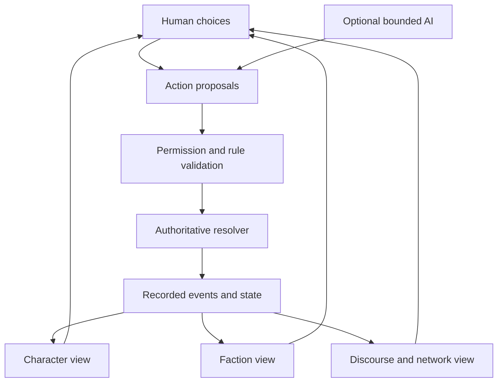

# NoöPunk: one God's-eye New Weird Grand Strategy RPG

**Status: LONG-TERM NORTH STAR. Aspirational.**

This document is a direction, not an instruction. It **authorizes no mechanics, no
canon, no numerical design and no scope**. It does not override
[`AGENTS.md`](../../AGENTS.md), and where the two ever disagree, `AGENTS.md` wins.
Nothing here is a commitment, a date, or a promise of AAA or MMO scale.

It exists for one purpose: **to keep the long horizon coherent while every actual
increment stays small.** The horizons in §7 are gates, not entitlements. Each one must
deliver a game that stands on its own; the full dream is optional and does not
retroactively justify building it now.

Sources: issue [#309](https://github.com/TomiToivio/NooPunk/issues/309) (this vision),
the crossover directive [#306](https://github.com/TomiToivio/NooPunk/issues/306), the
scaffold [#282](https://github.com/TomiToivio/NooPunk/issues/282) and its layer-design
tracks [#295](https://github.com/TomiToivio/NooPunk/issues/295) ·
[#296](https://github.com/TomiToivio/NooPunk/issues/296) ·
[#297](https://github.com/TomiToivio/NooPunk/issues/297).

**Reading test.** Having read only this file, an agent should be able to answer:
*(a) which game am I working on? (b) what may I build now? (c) what must I not do?
(d) where does the next increment go?* If it cannot, this document has failed and
should be fixed — by hand and by author review, never by a test (§10).

---

## 1. One universe, two games

There is **one fictional universe and two games** in this repository. The distinction is
binding and predates this document ([#306](https://github.com/TomiToivio/NooPunk/issues/306)):

| | Legacy NoöPunk RPG | NoöPunk × LaclauGPT crossover |
|---|---|---|
| Path | `RULEBOOK.md`, `rulebook/`, `src/`, `data/rules/` | `strategy_game/` |
| Rules | its own, unchanged | **NO RULES APPROVED** |
| Status | developed, not to be rewritten | active new game, H0 |
| Timeline | its own default campaign | **acceleration toward** the NHI Crisis |

- **Lore is shared.** Characters, institutions, NHI concepts and prior creative work
  carry over as common setting background, subject to scenario-specific deviations and
  author decisions. **Never delete or casually overwrite old lore.**
- **Rules are not shared.** Legacy attributes, skill procedures, lifepath, character
  sheets and gameplay are **not** canonical for the crossover. Cross-referencing is
  welcome; **importing a mechanic requires an explicit, author-approved conversion.**
- **The legacy RPG is never rewritten to accommodate the crossover.**

See §11 for which existing design documents govern which game — several are legacy-only
and must not be read as crossover doctrine.

## 2. The ultimate game: one Grand Strategy RPG with a God's-eye view

**There is exactly one game.** It is a **Crusader Kings III-style Grand Strategy / Roleplaying
game** in which the player holds a **God's-eye view**: a single overhead strategic map of the
political world, and the ability to zoom from that map all the way down to a named person —
without ever leaving the game, switching modes or starting a different one.

The player is **always a character**: someone with a history, relationships, loyalties,
ambitions and a position inside a faction, institution or state. Power is *held by a person*,
and it can be lost with that person. The strategic map is not a separate wargame layered on
top — it is **the same world seen from further away**, and every event on it resolves down to
people who can be named.

Character RPG, faction strategy, the LaclauGPT-inspired political simulation, geopolitics,
later space strategy and eventually multiplayer are **interacting subsystems of this one
crossover game** — not six games, not six modes, and not six camera perspectives. The
**overhead strategic map plus contextual panels is the enduring interface paradigm**: the map
is the constant, and panels, ledgers and character sheets open over it according to context.

This document uses the word *scale* throughout to mean **a zoom level of the one simulation**.
It never means a separate product.

**Primary genre: New Weird.** The setting is organized around paradigm shift, ontological
mystery and institutions under stress. Social science fiction, science fantasy,
geopolitical satire, investigative mystery, philosophical science fiction, cosmic
strangeness and cyberpunk are **supporting ingredients**. Cyberpunk is *secondary* — a
texture and a politics, not the organizing principle, despite the project's name.

The core period opens with the **acceleration toward the NHI Crisis**, in which three
shifts interact: AGI acceleration and cyborgization; UFO disclosure and NHI awareness;
and psychic awakening, psionics and psychotronics. Political disruption begins **before**
full crisis. Ideologies that emerge around these shocks — including AI doomerism, NHI
infiltration paranoia and novel single-issue populisms across the spectrum — are
simulated as **contestable perspectives, never as inevitable truths**.

Tone shifts contextually: comic, bureaucratically absurd, tragic, cerebral, genuinely
alien. New Weird is the umbrella; social science fiction and dark science-fiction comedy
are deliberate modes.

## 3. One game, many zoom levels

The God's-eye map is always present. Zooming in does not change the game — it reveals more
detail of the **same** simulation, and the same clock keeps running at every zoom level.
Nothing here is a mode the player enters or leaves.

The **Crusader Kings III structural model** is the benchmark: a named character with traits,
relationships, secrets and ambitions; an overhead map of realms, factions and networks; a
single turn structure advancing both together; and succession, rivalry and consequence
linking them, so that losing the person loses the power. NoöPunk's version keeps that spine
and replaces the feudal map with institutions, discourse networks and a state under
ontological stress.

| Domain (zoom level of the one game) | What the God's-eye map shows | What zooming in reveals |
|---|---|---|
| **Person** | a named figure, their affiliations, and the missions they are on | lifepath, relationships, dilemmas, meaningful choices and consequences — as an UNSA field agent, scientist, journalist, activist, diplomat, hacker, psychic, posthuman or faction leader |
| **Organization / faction** | blocs, cells, corporations, institutes and their rivalries across the map | leaders, assets, recruitment, operations, covert and overt power, delegation |
| **Society / discourse** | contested narratives flowing through communication networks | signifiers, frontiers, legitimacy and coalitions. **Abstract and gameable**, never the research stack |
| **Nation / planet** | states, institutions and the shape of global governance | diplomacy, UNSA, crisis response, science, conflict, surveillance, trust |
| **Solar system / beyond** | settlement and polities beyond Earth, once reachable | posthuman polities, asymmetric civilizations, unknown realities |
| **Persistent world** | other players' and LLM factions acting in the same history | delegated agents, asynchronous play, moderation and governance |

**Zoom-level continuity.** Consequence travels in both directions through one model: a
discovery can change a faction's strategy; its public reading can move discourse; alignment
can shift state policy; strategy can create personal missions. The player may **work at any
zoom level and delegate, abstract or ignore the others** — delegating is a decision inside the
game, not a switch to a different one.

*Illustrative causal chain — fiction, not a chosen mechanic:* an investigator finds
ambiguous evidence of possible NHI involvement → a faction leaks it → rival populists
frame it as liberation versus infiltration → communication networks amplify both frames →
legitimacy and coalitions shift → governments revise cooperation → new investigation and
diplomacy missions become playable. **Genuine ambiguity is preserved; nothing "must"
happen.**

## 4. Design pillars

These are written as **tests**, so a proposed feature can be rejected against them.

1. **New Weird first.** Paradigm shift and ontological mystery outrank hardware. NHI,
   PSI, AGI and psychotronics are game-world elements, **not claims about real science**.
2. **Social science as design, not as proof.** Laclau's content of struggle, Castells's
   network structure and power, and agent-based institutions give *interpretable*
   inspiration. The simulation is a **simplified game model**; no claim that theory
   mathematically determines an outcome is permitted.
3. **Character agency *and* structural forces.** Motivations and relationships coexist
   with faction strategy, ideology, networks and institutions. Neither spreadsheet
   geopolitics nor empty exploration.
4. **Something interesting at every scale, and little dead air.** Terra Invicta's breadth,
   far smaller and faster — dense decision loops, unexpected crises, real tradeoffs.
5. **Architect / Agent delegation.** Hands-on missions versus strategic orders;
   subordinates have interests and can surprise the player, while play stays legible.
6. **Human/LLM parity of *roles*, not of implementation.** A human or an AI may inhabit an
   NPC, leader, faction or diplomat — within explicit permissions, compute budgets and
   anti-abuse boundaries. LLM play is a bounded participant, never an unbounded optimizer.
7. **Simulation first, presentation later.** Headless world model and playable text/2D
   interfaces first; attractive interfaces next; cinematic 3D last, and only if resources
   exist.
8. **Persistent causality and legibility.** The game must be able to explain *why* society,
   loyalties and power changed. Deterministic rules, randomness, LLM-generated content,
   authored canon and in-world claims are **distinguishable**, always.
9. **Player and creator agency.** Scenario editing, faction and leader creation, modding
   interfaces, user campaigns, community storytelling — and, at the far horizon, shared
   world-building with moderation.
10. **Accessible scope.** Modular solo play must remain viable **even if** the MMO and AAA
    ambitions never happen. This pillar outranks the rest when they conflict.

## 5. Technical architecture (candidates, not commitments)

- **Engine-neutral, versioned** simulation and world-state API. Initial implementation
  lightweight **Python**, with explicit person / faction / discourse / world data
  contracts. Candidate libraries: dataclasses or Pydantic, NetworkX, optionally Mesa.
  **The core simulation must run with no LLM, no database service, no 3D engine and no
  network server.**
- **Independent layers:** RPG decision and resolution; character relationships and the
  organizational/agent layer; the simplified Laclau–Castells political simulation; global
  strategy; optional off-world simulation.
- **Model-assisted behaviour is a proposal layer.** Plug-in Ollama or cloud providers may
  generate dialogue, interpretation, deliberation and procedural scenarios. **LLM output
  never mutates authoritative state**; it is checked against authorized actions, canonical
  facts, rules and budgets.
- **Determinism and inspection:** recorded action/event log, seedable resolution,
  snapshots, replay tools, versioned schemas, explicit provenance. **Stochasticity lives
  in the proposal layer, not in the authoritative result.**
- **Interfaces:** start with an abstract/text or 2D overhead strategic map and contextual leader, faction, discourse, institution and event panels. Maintain this God’s-eye paradigm even at H5; Godot is an optional view client, not a locked engine. No embodied action/exploration camera.
- **Multiplayer, far later:** authoritative server, permissions, access-controlled state,
  rate limits, persistence, rollback and conflict resolution; human/human, human/LLM and
  LLM/LLM interaction **without unlimited autonomous operation**.
- **Modding and UGC:** data-driven events and entities, a documented scenario format,
  stable extension contracts, content provenance and licensing, moderation, optional
  publishing. **Never copy proprietary code, assets or rules text** from any referenced
  commercial game.

## 6. Reference studies

Inspiration for study, never a source to port. **No proprietary rules text, assets or code
is copied or depended upon.**

- **Terra Invicta** — multi-faction geopolitical and space strategy, councilors, crisis.
  Proprietary but moddable; a *prototype mod* path may be studied, but a total conversion
  must never be presumed releasable as a standalone product.
- **Democracy 4** — policy choices, voter blocs, feedback loops.
- **Crusader Kings III** — character-focused long-horizon strategy and emergent narrative.
- **Dune: Adventures in the Imperium** — Architect/Agent framing and strategic delegation.
- **Eclipse Phase** — deep transhuman and existential science fiction for the RPG layer.
- **Cyberpunk 2077** — inspiration for presentation polish, tone and production values, not first-person or third-person action gameplay.
- **Stellaris** — expandable civilization-scale strategy and emergent history.
- **EVE Online** — persistent player-led geopolitics, organizations, living economy.
- **Citizen Sleeper** and **Disco Elysium** — dense decisions, character voice, unusual
  institutions, minimal wasted movement.
- **NoöPunk tabletop rulebook and lore** — shared universe where relevant, but **the
  crossover is a separate scenario, game and rules implementation**, not a forced merger
  of rulebooks.

## 7. Horizons and gates

No dates. No commitments. **Every horizon must deliver a coherent game by itself**, and
each carries a **scope kill switch** — the thing that, if it is not working, gets cut
rather than rescued.

**H0 — Today: tiny, independent, actually playable.**
Three simple interlocking systems inside **one God's-eye, CK3-style strategic interface**:
an abstract board, a very small rule system, fast consequential turns. This is
[#282](https://github.com/TomiToivio/NooPunk/issues/282) and
its layer tracks [#295](https://github.com/TomiToivio/NooPunk/issues/295) ·
[#296](https://github.com/TomiToivio/NooPunk/issues/296) ·
[#297](https://github.com/TomiToivio/NooPunk/issues/297). Existing "no unapproved
mechanics or canon" instructions remain in force.
*Gate:* a complete, fun, explainable mini-scenario one person can finish.
*Kill switch:* any layer that cannot be explained on a table.

**H0 in three stages — approval before runtime.** *(Contributed by the parallel vision draft in
[#311](https://github.com/TomiToivio/NooPunk/pull/311) and kept here so the sequence is not lost:
editorial judgement gates the code, not the other way round.)*

- **H0-A — editorial and design gates, before any playable mechanics.** Review the three layer
  proposals **separately** with the author and other agents, selecting only the necessary leader
  attributes and tags, faction decisions, political representations and interactions. No new
  numerical ranges, costs, randomness or canonical actors are assumed. Write a **one-page
  vertical-slice proposal** naming the player, the initial tension, the integrated map and its
  contextual panels, one illustrative consequential decision, the ending and the estimated
  cognitive burden — author approval required before mechanics. Specify a **paper-playable
  version** of the proposed leader, faction and discourse rules, reviewed separately, with
  cross-layer event propagation as its own fourth gate. Identify which facts are historical,
  invented, factional, simulated or uncertain; **never conflate media reach with persuasion, or a
  game score with measured hegemony.**
- **H0-B — minimal runtime, after those approvals.** Python standard library as baseline, all
  adapters optional; the existing empty scaffold and view model are a starting point, not a
  request to restructure. Interfaces rather than a committed file layout: validated command
  intent, authorized rules resolver, versioned world snapshot, append-only event and provenance
  record, projections for character card, faction board and discourse graph **on one overhead
  strategy screen**, save/load/replay, and a minimal text or 2D strategy UI. One explicit player
  decision should yield a clearly explained event and changes visible in the linked panels
  **without leaving the map**. Seed randomness and record inputs so resolution can be replayed.
  Verified with **behavioural tests for executable code only** — command validity, save/load,
  deterministic replay, no unauthorized state mutation, consistent event-to-view projections —
  and never with tests over design prose, lore or canon.
- **H0-C — graduation.** The author has explicitly approved every mechanic and scenario element
  used; a fresh player can finish a complete session without reading the research framework;
  every meaningful change has an inspectable in-game explanation; the game runs, saves and loads
  **offline with no LLM, database, Mesa, Godot or server**; gameplay review — not documentation
  CI — validates the prose; and scope stays small, with no empty-turn slog or administrative
  micromanagement.

**H1 — Polished indie political RPG/strategy.**
Character creation and lifepath, leaders and agents, scenario authoring, dialogue and
events, an appealing 2D interface, coherent social-science-inspired rules, saves and
replay, one complete NHI-acceleration campaign.
*Gate:* repeatably enjoyable, not an impressive architecture diagram.
*Kill switch:* interface polish displacing rule coherence.

**H2 — Deep systemic living world.**
Factions evolve; characters form relationships and loyalties; policy and discourse
interact; local and global consequences become visible; optional bounded LLM character
play; robust scenario modding.
*Gate:* consequential emergent stories with understandable causes, at acceptable compute
cost and pacing.
*Kill switch:* LLM cost or latency becoming load-bearing for the experience.

**H3 — Grand-strategy expansion.**
Expanded Earth governance, UNSA diplomacy, geopolitics, space operations, posthuman
factions, further worlds and NHI contacts where appropriate.
*Gate:* strategic depth without idle-turn inflation.
*Kill switch:* any system that only produces waiting.

**H4 — Persistent multiplayer world.**
Private and co-op worlds first, then shared persistent servers with human and
LLM-controlled characters, safe creator tools and a clear governance model.
*Gate:* stable authoritative persistence, economical operation, moderation, anti-griefing,
auditability, retention.
*Kill switch:* a governance or moderation problem we cannot honestly solve.

**H5 — AAA-quality strategy presentation / MMO-scale horizon.**
High-fidelity overhead map, portraits, events, animation, sound and possible EVE-like persistence. **No switch to an embodied action RPG.**
This is a **funding, team and technology-dependent production horizon**, not something
today's Python scaffold must already support.
*Gate:* explicit production feasibility — team, funding, content pipeline, engine, online
operations, maintenance.
*Kill switch:* everything upstream of feasibility.

### Vision-versus-commitment ledger

| Horizon | Gate | Kill switch | Owning issue |
|---|---|---|---|
| H0 | a finishable, fun mini-scenario | a layer that cannot be explained on a table | #282, #295, #296, #297 |
| H1 | repeatably enjoyable | polish over coherence | *unassigned* |
| H2 | emergent stories with clear causes | LLM cost as a dependency | *unassigned* |
| H3 | depth without dead turns | systems that only produce waiting | *unassigned* |
| H4 | stable, governable persistence | unsolvable moderation/governance | *unassigned* |
| H5 | production feasibility | everything upstream of it | *unassigned* |

**Only H0 has an owning issue, and that is deliberate.** Assigning owners to H1–H5 before
H0 ships would be the scope creep this document exists to prevent.

## 8. Non-goals for current agents

- Do **not** treat the strategy RPG, grand strategy, AAA polish and MMO persistence as different products. They are optional maturity horizons of the ONE crossover game.
- Do **not** import the LaclauGPT research pipeline, claims of scientific causal certainty,
  or proprietary game content.
- Do **not** rewrite existing NoöPunk RPG rules, invent canon, select or implement new
  mechanics, or expand the scope of #282 / #295 / #296 / #297 without author approval.
- Do **not** replace local, testable rules with non-deterministic LLM-only gameplay.
- Do **not** require high-fidelity art, online infrastructure, enormous space maps or
  continuous simulation for the first playable prototype.
- Do **not** treat this document as approval for anything. It has none to give.

## 9. Open design artifacts

Each is a future piece of work, carried by a scoped issue rather than built from here.

- [ ] A **one-page playable vertical-slice pitch** — actions at person, faction and discourse scales.
- [ ] A **cross-scale world-state and event-flow architecture** — where consequence travels, and where simulation is abstracted.
- [ ] **Candidate engines, Python-to-engine bridges and licensed/modding prototypes**, findings kept non-binding.
- [ ] **Separation of human-played, LLM-played and rules-driven roles**, with the limits of delegation.
- [ ] The **horizon feature matrix** with dependencies and kill switches — extended from §7's ledger.
- [ ] **UGC governance** — moderation, canon conflicts, multiplayer trust, attribution.
- [ ] **Playtesting criteria** — engagement per minute, meaningful consequences per turn, clarity of power shifts, replayability, operational cost.
- [ ] A **discipline check**: the vision re-read against the three-layer prototype, so immediate development stays small.

## 10. How this document changes

- **Vision is not commitment.** Nothing here may be cited as approval, as a requirement, or
  as a reason to skip a gate.
- **Revisions go through an issue**, and land as a small reviewable change. An agent must
  not opportunistically extend this document while doing unrelated work.
- **Mechanics never live here.** If a proposal needs rules, statistics or numbers, it belongs
  in a scoped design issue, not in the vision.
- **This file is never guarded by tests.** Per `AGENTS.md` and
  [#271](https://github.com/TomiToivio/NooPunk/issues/271), the automated-test policy covers
  executable code only. No CI assertion, snapshot, schema lock or smoke step may check this
  document's prose, structure or wording. It is reviewed editorially and by playtesting.

## 11. Which documents govern which game

Several existing design documents belong to the **legacy RPG** and are not crossover
doctrine. Read them with the table in §1 in hand:

| Document | Governs |
|---|---|
| [`docs/design/GAMEPLAY_LOOP.md`](GAMEPLAY_LOOP.md) | legacy RPG |
| [`docs/design/DEFAULT_INVESTIGATION_FANTASY.md`](DEFAULT_INVESTIGATION_FANTASY.md) | legacy RPG — **post-Singularity** default campaign |
| [`docs/design/RULEBOOK_STRUCTURE.md`](RULEBOOK_STRUCTURE.md) | legacy RPG |
| [`docs/design/LORE_CHAPTERS_SCOPE_2026-10-07.md`](LORE_CHAPTERS_SCOPE_2026-10-07.md) | legacy RPG lore |
| [`strategy_game/docs/POLITICAL_SIMULATOR_SCOPE.md`](../../strategy_game/docs/POLITICAL_SIMULATOR_SCOPE.md) | crossover |
| [`strategy_game/docs/POLITICAL_SIMULATION_DESIGN.md`](../../strategy_game/docs/POLITICAL_SIMULATION_DESIGN.md) | crossover |
| [`strategy_game/docs/POLITICAL_SIMULATOR_MODEL.md`](../../strategy_game/docs/POLITICAL_SIMULATOR_MODEL.md) | crossover |
| [`strategy_game/docs/RULE_SYSTEM_RESEARCH.md`](../../strategy_game/docs/RULE_SYSTEM_RESEARCH.md) | crossover |
| [`strategy_game/docs/INTEGRATION_BOUNDARIES.md`](../../strategy_game/docs/INTEGRATION_BOUNDARIES.md) | crossover |
| [`strategy_game/RULEBOOK.md`](../../strategy_game/RULEBOOK.md) | crossover — **placeholder, NO RULES APPROVED** |

**The timeline warning is the one to internalize.** The legacy default campaign is set
*after* the Singularity. The crossover begins in the **acceleration toward** the NHI
Crisis, with everyday institutions and ordinary electoral politics still recognizable.
The two are not interchangeable, and this vision does not move either one.

---

*This document implements [#309](https://github.com/TomiToivio/NooPunk/issues/309). It grants
no permissions, changes no rules, and invents no canon.*

## 12. Proposed first playable slice

Implementation-plan baseline, inspected on 2026-10-11: `core.py` provides serializable `WorldState`, a schema-version field and provenance; `ports.py` contains reserved protocols. There is no playable turn engine. `politics.py` is integrated with `WorldState`, while `political.py` remains a separate vocabulary proposal. The plan below builds on that distinction.

**Proposal for discussion in #282 and #295–#297, not an approved scenario or mechanic.**

Player promise: lead a faction through a short, consequential episode of the acceleration toward the NHI Crisis, moving between a personal dilemma, an organizational decision and a visible public interpretation. Use an author-selected small cast and abstract board. Present choices as text and cards before investing in exploration or cinematic environments.

Adapt the illustrative chain in §3: ambiguous evidence reaches the player; the leader chooses a response; the faction acts or delegates; competing interpretations travel through the declared network; the approved resolver produces consequences; those consequences create the next personal decision. The ending should show what changed and why, including unresolved interpretations. Evidence, a faction's claim and an established fictional fact must remain distinguishable.

The first slice needs only the actions, resolution procedure and ending conditions selected in the three layer discussions. It must be playable by a human without an LLM and expressible with a physical board/cards/dice if the approved rules require them. No numbers, action economy, dice model, faction taxonomy or canonical incident are selected here.

## 13. Cross-scale authority and event flow

**Proposed future architecture.** The current scaffold stores declared data; the command validator, resolver and replay machinery below do not exist yet. Implement only the portion required by an approved slice.

One accepted action is resolved once. Views show its consequences; they do not independently recalculate or award them. Approved cross-scale consequences become explicit events, with causal references, rather than hidden mutations inside UI or dialogue. Later scales can use coarser updates; identical tick rates and continuous global simulation are unnecessary.

Start from `core.py`, `ports.py`, `provenance.py` and `view.py`, preserving the boundaries in [INTEGRATION_BOUNDARIES.md](../../strategy_game/docs/INTEGRATION_BOUNDARIES.md). Extend serialization only as needed. A future replay record should identify the initial snapshot, rules/schema versions, accepted inputs, recorded random outcomes and resulting events. A seed alone cannot reproduce changing model responses or changed code. Record accepted LLM proposals; replay must not call the model again.

| Controller | May do after relevant rule approval | Authority boundary |
| --- | --- | --- |
| Human | Choose a permitted action, inspect available information, delegate | Same action validation as other controllers |
| Rules-driven actor | Select among approved actions using an explicit policy | No privileged state mutation |
| Optional LLM actor | Propose structured actions and dialogue from permitted context | Validate actor identity, knowledge, action permissions and budget; reject invalid proposals |
| Resolver | Apply approved rules and recorded randomness | Sole writer of resolved gameplay state |
| Scenario author / GM | Supply approved content and use explicitly defined GM capabilities | Authored content and interventions retain provenance; no silent canon promotion |

Delegation needs an explicit mandate, stopping conditions and an inspectable result. Permissions concern both what an agent can do and what it can know. Timeouts and invalid model output must have an approved fallback, such as returning control to the human; they must not invent an action or outcome.

## 14. Implementation sequence grounded in the repository

These are proposed work packages, not additional authorization. Continue the existing issues rather than opening duplicate implementation tracks.

| Step | Existing home | Concrete deliverable | Exit condition |
| --- | --- | --- | --- |
| A. Select the minimum rules | #295 leader; #296 faction; #297 discourse/network | Author-selected procedures recorded in `strategy_game/RULEBOOK.md`, including unresolved questions | Each selected procedure can be exercised without software |
| B. Reconcile the data model | #282 integration and #297 vocabulary | Explicit mapping or consolidation decision for `politics.py` and `political.py`; stable identifiers and provenance semantics | One agreed representation for slice transitions; no silent loss of existing records |
| C. Specify the shared turn | #282, after A and B | Inputs, action ownership, ordering, randomness, rejection behavior and cross-layer consequences | An author-reviewed worked turn explains every state change |
| D. Implement the small resolver | Scoped follow-up to #282 | Headless Python implementation of the approved procedures and executable behavior tests | Human-controlled slice runs offline; views cannot alter state |
| E. Make the slice finishable | #282 integration, after C and D | Approved scenario, text interface, end summary, save/load and inspectable event history | One person can finish and explain the consequences |
| F. Playtest before expansion | #282; later H1 decision | Playtest notes and a small prioritized revision list | Author accepts pacing, clarity and replay value before adding scope |

Rule selection, not engine selection, is the immediate dependency. NetworkX, Mesa, a database, Godot, Concordia and model providers remain optional candidates. Select libraries only when an approved requirement makes the standard-library approach inadequate. Do not build a distributed platform to serve an empty turn loop.

### Horizon feature/dependency ledger and scope kill switches

| Horizon | Deliverable focus | Dependency and evidence for proceeding | Scope kill switch | Status / work home |
| --- | --- | --- | --- | --- |
| H0 | Tiny leader–faction–discourse slice | Steps A–F; a complete explainable episode | Reduce scenario breadth and presentation; retain consequential choices | Scaffold exists; rules pending in #282/#295–#297 |
| H1 | Complete indie campaign, authoring tools and polished 2D play | H0 enjoyment established; usable saves and coherent content pipeline | Keep text/cards; postpone engine migration and cinematic scenes | Unscheduled proposal |
| H2 | Relationships, political feedback, bounded optional LLMs and mods | H1 causal legibility; measured cost and reproducibility | Disable model agents; retain authored content and rules-driven play | Unscheduled proposal; #304 is related agent design, not MMO approval |
| H3 | Broader Earth strategy and selective off-world expansion | H2 pacing survives greater breadth; profiling supports expansion | Abstract distant regions; defer space or additional civilizations | Unscheduled proposal |
| H4 | Private/co-op persistence, then shared worlds | Explicit permissions, conflict handling, recovery and governance; affordable operation | Keep local saves or private small worlds; postpone public servers | Unscheduled proposal |
| H5 | Cinematic production and potentially MMO-scale concurrency | Funded team, production pipeline and demonstrated online feasibility | Ship the smaller game; no AAA/MMO dependency imposed on earlier horizons | Aspirational only |

## 15. Playtest and research plan

Collect evidence for gates instead of setting arbitrary numerical targets now. Establish a baseline with the first playable slice, then agree targets with the author.

| Question | Evidence to collect | Design response if it fails |
| --- | --- | --- |
| Is time spent deciding? | Session duration, decision points and idle/repetitive intervals | Cut upkeep and empty turns |
| Do choices matter? | Consequences traceable to chosen actions; comparison of alternative playthroughs | Revise approved options and feedback before adding content |
| Can players explain political change? | Player account of changes compared with the event history | Improve explanations and simplify hidden interactions |
| Is the story worth replaying? | Different strategies and endings within approved scenario content | Improve consequential variation, not map size |
| Can it run economically? | Turn latency; optional model calls, tokens and cost per session | Reduce model frequency or use rules-driven actors |

Tests cover executable behavior once implemented: rejected actions leave state unchanged, accepted consequences apply once, save/load preserves state, and replay reproduces recorded resolutions under the same versions. Review this vision and all creative content editorially and through playtesting. Add no prose, canon or rulebook CI gates.

### Research still required

The references in §6 are study prompts, not completed comparative research. The existing issue discussion additionally suggests **Suzerain**, **Dwarf Fortress** and **Mount & Blade** for studying political narrative and cross-scale continuity. Assess those references before selecting adaptations.

Before choosing a frontend, compare a minimal text/card client with candidate Python and engine clients against the same approved slice: input, accessibility, packaging, save compatibility and deployment effort. Before proposing a proprietary-game mod, verify the current official modding documentation and redistribution permissions. A mod experiment must not become a dependency of the standalone game.

Before H4, separately decide scenario-versus-world canon, creator attribution and licenses, content validation, moderation and appeals, hidden-information access, griefing controls, server recovery and incompatible mod handling. These need explicit design and operational decisions; a provenance field alone does not solve them.

## 16. Document acceptance and maintenance

This file supplies a first slice pitch, proposed event-flow diagram, controller boundaries, implementation sequence, horizon ledger and playtest plan. Engine research, detailed UGC governance and the actual mechanics remain open. These proposals do not mark the issue's entire research checklist complete.

A reader should be able to identify the game they are working on, the existing rule-authoring issues, the next scoped deliverable and the conditions for stopping expansion. Review that manually. Direct author instructions and approved scoped decisions govern implementation; a vision edit alone does not approve mechanics or expand a milestone.

Reconcile this document when #309 or the relevant author decisions change, updating the reconciliation date and preserving the distinction between implemented capability and aspiration. Keep #309 available as the north-star discussion; completion of this document does not mean the ultimate game has been implemented.

## 15. Merge reconciliation: map-first vision and H0 design gates

**One primary screen:** a CK3-like overhead map/abstract board, zoomable across strategic domains where useful, plus contextual character sheets, faction orders, discourse/network panels, policy and diplomacy panels, and event dialogue. One authoritative world event feeds those views. Show separately **what happened**, **who claims what**, **what the approved rules changed**, and **what remains unknown**. Neither a mission nor the solar-system expansion adds a separate embodied exploration game.

**H0-A, design approval first:** review #295 (leader/NPC), #296 (faction), and #297 (discourse/network) separately. Propose a one-page, paper-playable vertical slice with the player's role, initial NHI-crisis acceleration tension, one consequential choice, same-screen projections and clear end condition. Approve cross-layer event propagation as a fourth gate. No mechanic, numeric system, scenario canon or launch commitment is approved by this vision.

**H0-B, small executable slice after approval:** retain an offline Python-standard-library baseline. Proposed pipeline: validated command intent → authorization → approved deterministic resolver → authoritative world state → recorded event/provenance → consistent map, leader, faction and discourse projections. Save/load and deterministic replay should record accepted actions, versioned rules and any randomness; optional LLM text is only a proposal. Test executable behavior, never prose or canon wording.

**H0-C, graduate through playtesting:** one complete replayable, fast-paced scenario that a fresh player understands and can finish; inspectable causal outcomes, coherent panel interaction and no dependency on LLM, MongoDB, Godot, servers or a planetary simulation. Only then consider H1. H1–H5 are successive versions of the **same** God’s-eye grand-strategy RPG, never six separate games or playing modes.

**Kill switches:** if politics is opaque simplify projections; if turns have dead air cut low-value events; if inference costs grow bound/disable agents; if online governance fails stay offline/co-op. Keep separate sourced reality, accepted science, actor claims, authored world premises, simulated consequences and unresolved mystery.

*This section carries the distinctive user clarification and H0 sequencing from PR #311 while retaining main's existing detailed implementation and governance sections.*
